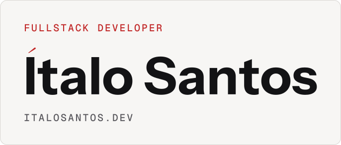

<a href="https://italosantos.dev/en">
  <picture>
    <source media="(prefers-color-scheme: dark)" srcset="assets/card-dark.svg">
    
  </picture>
</a>

Hi, I'm Ítalo, a fullstack developer from Brazil. I work in TypeScript across the stack: React and Next.js up front, Node.js and NestJS behind.

More about me at [italosantos.dev](https://italosantos.dev/en).
